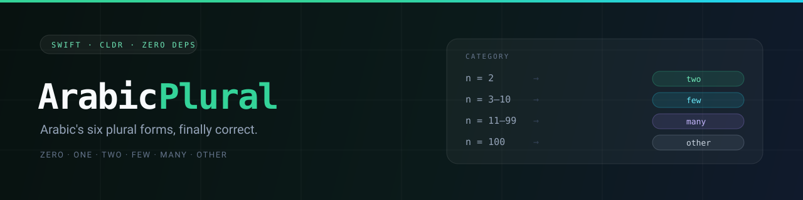

<p align="center">
  
</p>

# ArabicPlural

Arabic has six plural forms. This applies them correctly in Swift.

| `n` | form | example |
| --- | --- | --- |
| 0 | `zero` | لا رسائل |
| 1 | `one` | رسالة واحدة |
| 2 | `two` | رسالتان |
| 3–10, 103, 1003… | `few` | ٣ رسائل |
| 11–99, 111, 199… | `many` | ١١ رسالة |
| 100, 101, 102, 1.5… | `other` | ١٠٠ رسالة |

The rule is only about `n % 100`, which is why the boundary cases (100, 101, 102, 103) are
where most implementations break. The common shortcut is this:

```swift
// compiles, and reads wrong in Arabic
count == 1 ? "رسالة واحدة" : "\(count) رسائل"
```

It produces `٢ رسائل` and `١١ رسائل`. Both should be different forms.

## Install

```swift
.package(url: "https://github.com/hfip/ArabicPlural.git", from: "0.1.0")
```

```swift
.target(name: "MyApp", dependencies: ["ArabicPlural"])
```

iOS 13+ / macOS 10.15+ / tvOS 13+ / watchOS 6+. No dependencies, 16 tests.

## Use

```swift
import ArabicPlural

ArabicPlural.category(for: 2)     // .two
ArabicPlural.category(for: 7)     // .few
ArabicPlural.category(for: 42)    // .many
ArabicPlural.category(for: 100)   // .other
ArabicPlural.category(for: 1.5)   // .other
```

If you already have templates per form, hand them over and let the package pick one:

```swift
let templates: [ArabicPluralCategory: String] = [
    .zero:  "لا رسائل",
    .one:   "رسالة واحدة",
    .two:   "رسالتان",
    .few:   "# رسائل",
    .many:  "# رسالة",
    .other: "# رسالة",
]

let arabic = Locale(identifier: "ar")
ArabicPlural.format(templates, count: 7, locale: arabic)   // "٧ رسائل"
ArabicPlural.format(templates, count: 42, locale: arabic)  // "٤٢ رسالة"
```

`#` is the only placeholder the formatter understands, and it is replaced with the number
formatted for the locale you pass (`.current` by default, so English devices get `7`, not
`٧`).

## API

| | |
| --- | --- |
| `ArabicPluralCategory` | `zero`, `one`, `two`, `few`, `many`, `other` |
| `category(for: Int)` | uses the magnitude, so `-7` is `.few` |
| `category(for: Double)` | fractional and non-finite values are `.other` |
| `format(_:count:locale:)` | picks the template, substitutes `#` |
| `numberString(_:locale:)` | localised digits, no grouping separators |

Two details worth knowing: `Int.min` is handled without trapping on `abs`, and the category
function is plain integer arithmetic, so it is safe to call from a SwiftUI body.

Dependencies follow the [CLDR rules for `ar`](https://www.unicode.org/cldr/charts/45/supplemental/language_plural_rules.html).

## بالعربي

<div dir="rtl" align="right">

أغلب التطبيقات تفرّق بين المفرد والجمع بس، والعربية فيها ست صيغ:

- `٣–١٠` → few، مثل «٣ رسائل»
- `١١–٩٩` → many، مثل «١١ رسالة»
- `١٠٠ و١٠١ و١٠٢` → other، مثل «١٠٠ رسالة»

الحزمة صغيرة وبدون اعتماديات، وتشتغل من iOS 13:

```swift
ArabicPlural.format(templates, count: 7, locale: Locale(identifier: "ar"))
```

</div>

## License

MIT. See [LICENSE](LICENSE).
